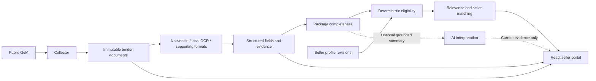

# Project architecture

The core path is deterministic and does not require AI:

FastAPI provides authenticated seller and operator routes. SQLAlchemy/SQLite store discovery history, immutable versions, extracted sources, evidence, seller revisions and match reasons. Persisted jobs and bounded workers handle ingestion; the demo disables broad workers and scheduling.

Acquisition validates HTTPS hosts, redirects, content and limits. Extraction handles native PDFs, optional bounded Tesseract OCR, supported Office/text/image files and conservative static catalogue layouts. Source pages and logical table/row/cell locations remain attached to extracted facts.

The eligibility engine compares known requirements with the active seller revision. Relevance and eligibility remain distinct; unresolved material coverage, missing information and conflicts preserve review. Matching caches are invalidated by seller/source/engine/AI-input identity changes. Portal membership checks apply to every seller-scoped request and document download.

React presents dashboard, filters, tender documents, structured details, evidence, match reasons and profile editing. Current optional AI summaries can supplement this path. No AI result, provider failure or unavailable key prevents deterministic evaluation of a usable complete package. Free-form clauses that lack supported deterministic interpretation remain review; optional AI is not an invented substitute.
