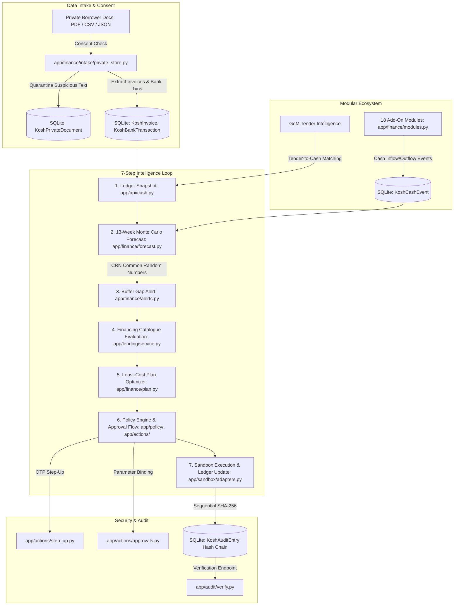

# Kosh Architecture & System Design

Technical architecture and engineering specification for Kosh, the deterministic cash-flow intelligence and safeguarded intervention system for Indian MSMEs.

---

## 1. System architecture

---

## 2. The 7-Step Closed Loop

Kosh continuously guides an enterprise through a deterministic seven-step decision loop:

1. **Intake & Consent Enforcement** (`app/finance/intake/`, `app/consent/`):
   Borrower documents (sales invoices, purchase bills, bank statements, books registers) are ingested only after verifying an active purpose-limited consent under DPDP Act principles (`app/consent/service.py:36`). Files are checked for magic bytes, size limits, and scanned for prompt injection attacks. Suspicious instruction text flags documents for human review (`REVIEW`), preventing automated processing.
2. **Ledger & Business Snapshot** (`app/api/cash.py:24-36`):
   Computes verified receivables, verified payables, overdue amounts, and latest bank balance. Invoices flagged for review (such as poisoned documents) are quarantined and reported separately (`held_for_review_payables_paise`), protecting liquidity projections from untrusted data.
3. **13-Week Monte Carlo Forecast** (`app/finance/forecast.py:120-220`):
   Runs 2,000 deterministic Monte Carlo paths over a 13-week horizon using Common Random Numbers (CRN) seeded with a fixed PRNG seed (default `seed=42`). Empirical customer payment delay distributions model receivable cash arrivals.
4. **Buffer Gap Alerts & Root Cause Attribution** (`app/finance/alerts.py:7-23`):
   When a projected week's shortfall probability exceeds the threshold (default 50%), an alert is raised. Counterfactual simulation (`customer_delay_shift_days={party_id: -365}`) determines the marginal contribution of each customer's overdue balance and clusters obligations (e.g. GST, insurance).
5. **Financing Catalogue & Plan Optimization** (`app/lending/`, `app/finance/plan.py`):
   All 8 statutory and market financing products (TReDS, Bank OD, Collections push, Supplier extension, MUDRA, CGTMSE, NBFC, GeM Sahay) are evaluated against entity criteria. The optimizer runs a greedy algorithm ordering matched options by *cost per net rupee delivered*, trimming capacity to satisfy the target safety probability across the full horizon (`ALL_WEEKS`).
6. **Safeguarded Action Intents & Approvals** (`app/actions/`, `app/policy/`):
   Action intents can ONLY be spawned from trusted plan lines. The policy engine assigns strict tiers:
   - `T1` Draft: Non-financial parameter edits.
   - `T2` Operational: Collections reminders to allowlisted counterparties.
   - `T3` Capital Disbursement: Financial obligations requiring OTP and another approver when one exists and 6-digit OTP step-up verification.
   - `T4` Blocked: Unstructured free-text payment orders or poisoned document instructions are rejected immediately.
7. **Sandbox Execution & Verifiable Audit** (`app/sandbox/`, `app/audit/`):
   Simulated settlement runs through local sandbox adapters, respecting virtual clock cool-offs (e.g. 24-hour beneficiary addition delay). All transitions, approvals, and outcomes are permanently appended to an immutable SHA-256 hash chain (`KoshAuditEntry`).

---

## 3. Data Model Summary

All models are defined in `app/database/kosh_models.py` using SQLAlchemy Declarative Base with strict type constraints:

| Model | Table | Purpose | Key Columns / Constraints |
| :--- | :--- | :--- | :--- |
| `KoshPrivateDocument` | `kosh_private_documents` | Tracked borrower files | `id`, `seller_id`, `kind`, `status` (`UPLOADED`, `PROCESSED`, `REVIEW`), `consent_id` |
| `KoshPrivateDocumentVersion` | `kosh_private_document_versions` | Deduplicated content storage | `sha256` (hex digest), `size_bytes`, `storage_key`, `detected_format` |
| `KoshInvoice` | `kosh_invoices` | Accounts receivable / payable | `amount_paise`, `direction` (`RECEIVABLE`/`PAYABLE`), `status` (`OPEN`, `PAID`, `REVIEW`), `due_date` |
| `KoshCounterparty` | `kosh_counterparties` | Customers and vendors | `gstin`, `treds_onboarded`, `is_cpse`, `credit_rating` |
| `KoshBankTransaction` | `kosh_bank_transactions` | Ingested bank statement rows | `account_ref_masked` (`****1234`), `amount_paise`, `balance_paise`, `txn_date` |
| `KoshObligation` | `kosh_obligations` | Fixed recurring commitments | `label`, `amount_paise`, `recurrence`, `next_due_date` |
| `KoshForecastRun` | `kosh_forecast_runs` | Monte Carlo run metadata | `input_fingerprint` (SHA-256 of inputs), `n_paths`, `seed`, `buffer_paise` |
| `KoshForecastWeek` | `kosh_forecast_weeks` | Weekly probability distributions | `week_index` (1..13), `prob_below_buffer`, `expected_shortfall_paise`, `p10`, `p50`, `p90` |
| `KoshAlert` | `kosh_alerts` | Buffer breach alerts | `week_index`, `probability`, `expected_shortfall_paise`, `causes` (JSON) |
| `KoshFinancingResult` | `kosh_financing_results` | Product eligibility evaluation | `product_id`, `status` (`MATCHED`, `NOT_MATCHED`, `REVIEW_REQUIRED`), `eligible_capacity_paise` |
| `KoshPlan` | `kosh_plans` | Optimized financing plan | `status` (`VALID`, `INSUFFICIENT`, `STALE`), `total_cost_paise`, `baseline_cost_paise` |
| `KoshPlanLine` | `kosh_plan_lines` | Individual plan allocations | `product_id`, `amount_paise`, `cost_paise`, `effective_annual_rate`, `required_tier` |
| `KoshActionIntent` | `kosh_action_intents` | Immutable action proposal | `params_hash`, `tier` (`T1`..`T4`), `status` (`PROPOSED`, `APPROVED`, `EXECUTED`, `BLOCKED`) |
| `KoshApprovalArtifact` | `kosh_approval_artifacts` | Signed execution tokens | `jti`, `approver_id`, `token_hash`, `expires_at` (5 min TTL) |
| `KoshOtpChallenge` | `kosh_otp_challenges` | Dual-control step-up challenge | `code_hash` (HMAC), `attempts` ($\le 3$), `expires_at` |
| `KoshAuditEntry` | `kosh_audit_entries` | Cryptographic hash chain | `sequence` (monotonic 1..N), `prev_hash`, `params_hash`, `entry_hash` |
| `KoshCashEvent` | `kosh_cash_events` | Modular ecosystem cash flows | `module_name`, `amount_paise`, `direction`, `event_date` |

---

## 4. Core algorithms

### Monte Carlo Simulation with Common Random Numbers (CRN)
- **Empirical Delay Modeling** (`app/finance/forecast.py:145-175`):
  Receivable cash inflow dates are sampled from historical customer delays. When history is insufficient, portfolio-wide delay quantiles are applied.
- **Common Random Numbers (CRN)**:
  By fixing the random seed across comparative runs (`seed=42`), the optimizer compares baseline vs. intervention trajectories under identical simulated macro shocks, eliminating Monte Carlo sample noise.
- **Fingerprinting & Stale Plan Detection** (`app/finance/forecast.py:34`):
  Inputs are hashed via SHA-256 (`input_fingerprint`). If invoices or bank transactions change between plan creation and action proposal, the plan is marked `STALE` and refused execution.

### Least-Cost Optimization Algorithm
- **Metric**: Cost per net rupee delivered over the quoted tenor:
  $$\text{Unit Cost} = \frac{\text{Cost (paise)}}{\text{Net Cash (paise)}}$$
- **Horizon-Wide Safety Target (`ALL_WEEKS`)** (`app/finance/plan.py:220-310`):
  Guaranteed levers (TReDS, Bank OD) are added greedily until **every horizon week** satisfies $P(\text{closing balance} < \text{buffer}) \le 0.20$.
- **Guaranteed Plan vs Expected extra from Collections**:
  - *Guaranteed Plan*: Committed capital disbursements with contractual certainty. Used to assert mathematical validity against the 0.20 safety threshold.
  - *Expected Plan*: Operational collection reminders under the MSMED Act Section 15/16. Helpful for cash acceleration, but classified as uncertain and excluded from formal safety proof.

---

## 5. Security design

### Policy Engine & Segregation of Duties
- **Four-Eyes Control (Dual-Control)** (`app/actions/approvals.py:55`):
  For any `T3` disbursement action, if more than one approver/owner exists in the enterprise, the user who proposed the intent is forbidden from providing the executable approval (`SECOND_APPROVER`).
- **Simulated OTP Step-Up** (`app/actions/step_up.py:20`):
  Requires a 6-digit challenge code verified against an HMAC-SHA256 digest with maximum 3 attempts and a 5-minute lifetime.
- **Short-Lived Single-Use Approval Tokens** (`app/actions/approvals.py:24`):
  Signed with a 256-bit secret, bound to the immutable `params_hash`, valid for 300 seconds, and consumed immediately upon execution. Replay attempts trigger a security alert.
- **Immutable Hash Chain** (`app/audit/ledger.py`):
  Every state modification records an event where:
  $$\text{entry\_hash} = \text{SHA256}(\text{prev\_hash} \,\|\, \text{sequence} \,\|\, \text{action} \,\|\, \text{params\_hash} \,\|\, \text{recorded\_at})$$
  Ensures tamper-evident traceability verifiable via `GET /api/kosh/sellers/{id}/audit/verify`.

### Back-test and limits

`app/finance/backtest.py::run_backtest` evaluates 12 rolling historical weekly origins with 500 paths each, comparing horizons 1–4 against recorded bank balances. Forecast inputs stop at the origin to avoid future-data leakage. Coverage uses the P10–P90 interval with a historical volatility margin. `mape_p50_inflow` is currently a placeholder, not measured accuracy; coverage on the fictional seed data is not production calibration. See `tests/test_kosh_stage2.py`.

### Financing eligibility with evidence

`app/lending/service.py` evaluates catalogue rules per entity and, where relevant, invoice scope. `MATCHED` means the recorded evidence satisfies criteria; `NOT_MATCHED` means a criterion fails; `REVIEW_REQUIRED` means evidence is missing or needs confirmation. Each result retains reasons and evidence references. Matching one invoice does not imply every invoice is eligible. Tests: `tests/test_kosh_stage3.py`, `tests/test_kosh_financing_evidence.py`.

### Same-seed allocation and safety proof

`app/finance/plan.py` orders usable matched levers by quoted cost divided by net proceeds, respects capacity and arrival/repayment dates, and simulates the resulting cash events using the baseline seed and paths. The `ALL_WEEKS` proof requires every one of 13 post-plan probabilities to meet the selected threshold; `app/actions/planner.py` rechecks the proof and forecast fingerprint before proposing an executable intent. This is a simulated safety constraint, not a guarantee about real cash arrivals or global optimality. Collections remain expected cash and do not fabricate guaranteed balances. Tests: `tests/test_kosh_stage3_2.py`, `tests/test_kosh_stage4_intents.py`.

### MSMED Section 16 interest

`app/finance/collections.py::msmed_interest` uses integer paise, three times the supplied RBI bank rate, monthly compounding rests and a remaining-day stub. Statutory terms and MSE eligibility must be evidenced before claims are asserted. The demonstration rate is a dated fixture. Tests: `tests/test_kosh_stage5_collections.py`.

### Permission tiers and execution boundary

`app/policy/rules.py` implements T0 read/compute and T1 internal drafts automatically, T2 communications with human approval, T3 money/data-sharing with human approval and OTP, and T4 forbidden actions. `app/actions/integrity.py` and `app/actions/planner.py` bind canonical parameters to trusted plan provenance. `app/actions/approvals.py` uses HMAC-SHA256 signatures, exact parameter binding, expiry and single-use consumption. `app/actions/step_up.py` enforces OTP expiry and attempt limits; `app/consent/sharing.py` checks purpose, recipient and fields.

`app/sandbox/adapters.py` performs local simulated settlement and messaging. Global/tenant kill switches in `app/policy/controls.py` and `app/policy/rules.py` gate actions. Intake scanning in `app/finance/intake/service.py` quarantines instruction-bearing documents; document-origin payment parameters are denied. `app/audit/ledger.py` chains canonical payload digests and event metadata; `app/audit/verify.py` detects modification. Hash chaining is tamper evidence, not protection against a privileged administrator replacing the whole chain. Proof mapping: [Permission-tier implementation](SECURITY_SELF_ASSESSMENT.md#permission-tier-implementation).
